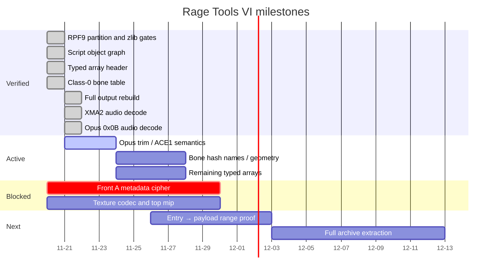
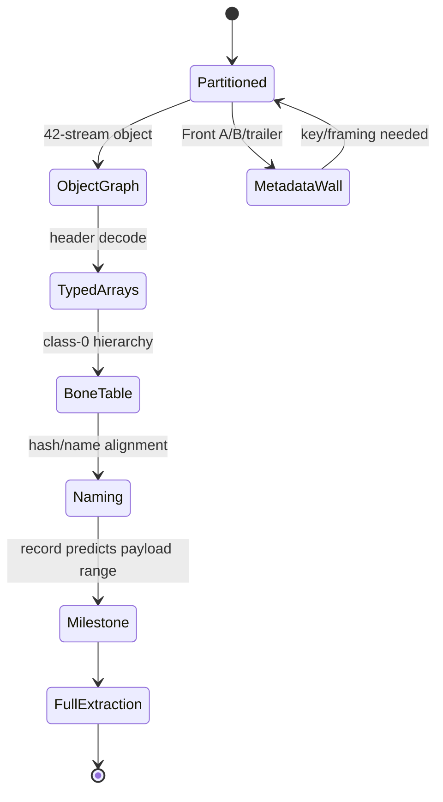

# Roadmap

The roadmap is a living section. `plan.md` is the canonical live check/todo
list and this page is the visual projection; evidence lives in
`investigation.md`.

## Milestones

## State

## Current work

| Priority | Task | Evidence | Blocker |
| --- | --- | --- | --- |
| 1 | Opus trim and 0x02 semantics | 2,081 Opus WAVs / 73 ACE1 IRs | pre-skip and trailer pairs |
| 2 | Name or align the 612 bone hashes | `handoff/script-bones.tsv` | hash namespace |
| 3 | Geometry-classify bones | `handoff/script-bone-points.tsv` | no model orientation |
| 4 | Decode remaining typed arrays | `0xb066759f`, `0xb1ee00d0` | field semantics |
| 5 | Front A milestone | metadata size model | key/framing/decoded field |
| 6 | Texture top-mip verification | spinner + HUD holdouts | codec/pitch/tile |

## Done

- [x] Map `common.rpf` stored ranges and payload groups.
- [x] Verify the 42-stream object, PSIN records, XML, and story control.
- [x] Confirm metadata region sizes and header invariants.
- [x] Map the `LSNS` tables: 16-byte records, framing valid on 1,012/1,012 records.
- [x] Resolve the 64 KiB continuation rule.
- [x] Name 306 of 483 object roots with JOAAT.
- [x] Decode typed array headers and the `vector3` type tag.
- [x] Flatten the 44 class-0 bone tables and 3,043 bones.
- [x] Rebuild all six verified archive extractions after a clean output wipe.
- [x] Decode 151 AWC codec-`0x05` streams as XMA2 WAV.
- [x] Decode 2,081 AWC codec-`0x0B` streams as untrimmed Opus WAV.
- [x] Decode 73 AWC codec-`0x02` streams as ACE1 impulse responses.

## Parked

- 331,728-byte blob; revisit after a PC launch or new sample.
- Full RPF9 metadata key recovery; needs key material or a second build.
- Format `0x62` texture codec until a verified control exists.
