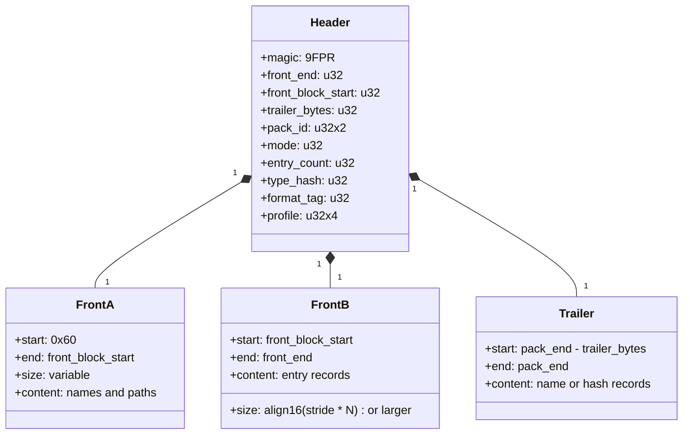
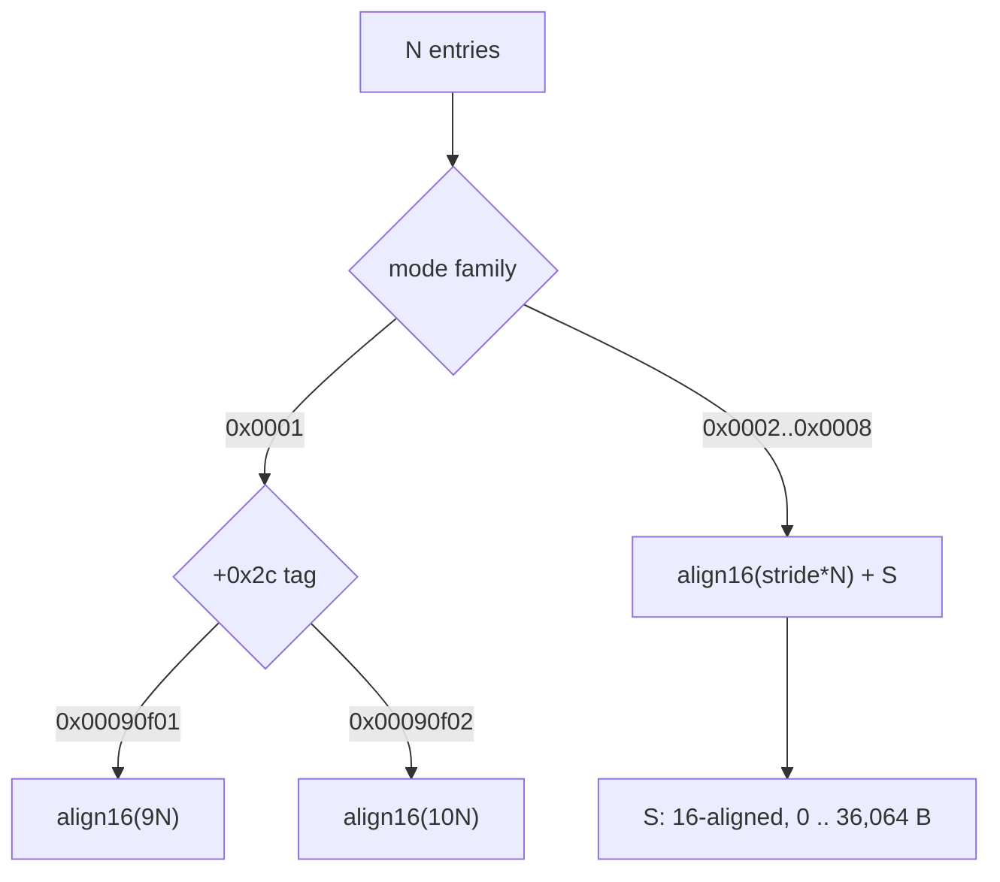
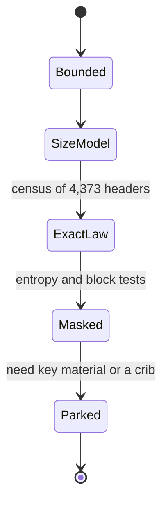

# Metadata regions

The metadata wall is the boundary between “the archive can be partitioned” and
“the archive index can be decoded.” The bytes are bounded, the region sizes are
now modelled from the entry count, and every metadata region is masked.

The sizes and invariants below come from a census of **4,373 RPF9 headers**
across the 22-archive source tree (`handoff/header-census-full.tsv`,
`handoff/header-words.tsv`).

## Region contract



| Region | Bounds | Observed property | Status |
| --- | --- | --- | --- |
| Front A | `0x60 .. word_08` | variable; grows with N and name length | masked |
| Front B | `word_08 .. word_04` | `align16(9N)` or `align16(10N)` for mode family 1 | masked |
| Trailer | `end - word_0c .. end` | `word_0c` equals the trailer length in all 4,373 headers | masked |

## Front B size model

Front B is a fixed-stride entry table. For every header in mode family
`0x0001` (2,908 of 4,373) the size is exactly `align16(stride * N)`, where the
stride is selected by the `+0x2c` tag:

| `+0x2c` | Headers | Stride | Exact fits |
| --- | ---: | ---: | ---: |
| `0x00090f01` | 2,414 | 9 bytes | 2,414 / 2,414 |
| `0x00090f02` | 494 | 10 bytes | 494 / 494 |

The tag is a **count-driven format tag**, not a build version: `0x00090f01`
covers N = 1…254 and `0x00090f02` covers N = 257…27,172, with no overlap and no
header at N = 255 or 256.

Because the law is `align16(10N)` exactly, the extra byte is **inside every
record**, not a per-pack header byte (that would give `align16(9N + c)`). A
per-record index running 0…N−1 fits a `u8` up to N = 256 and forces the flip at
N = 257; a per-record count running 1…N forces it at N = 256. Both readings
survive because this build has no pack at either count.

Mode families `0x0002`–`0x0008` add a 16-byte-aligned extra table
`S = Front B − align16(stride * N)`. `S` is 0 for the smallest family-2 packs and
grows to 36,064 bytes; family 4 is the tightest at 224 bytes per entry (±8),
which points at a fixed-size per-entry descriptor. The localization cohort is
the special case `S = 2N + 12`, which is why it also fits `12N + 12` and cannot
distinguish the two readings on its own.



## Masking evidence

For each header, the plug-in byte entropy of Front B was compared with the
expected entropy of a uniform random sample of the same length (Monte Carlo
below 1,000 bytes). The deficit is median 0.000, p75 0.009, max 0.357; only 64
of 4,373 regions exceed 0.15, and all are 16–80-byte samples where the
statistic is coarse. All 4,373 first and all 4,373 last 16-byte blocks are
distinct.

No pack in the corpus has a plaintext Front B table. The remaining route is key
material or a known-plaintext crib, not more scanning.

Cross-pack comparison is unavailable: across the thirteen `data.rpf`
localization packs, which share N = 1,115 and a byte-identical 29,856-byte
trailer, **0 of 13,392 Front B offsets are stable** and byte agreement is at
chance (`tools/front_b_stability.py`). The trailer chain is pack-independent;
the Front B chain is not, or its plaintext is pack-specific in every record.

## Header word map

| Offset | Role | Evidence |
| --- | --- | --- |
| `+0x00` | magic `9FPR` | constant |
| `+0x04` | `front_end` | 16-aligned, equals Front B end |
| `+0x08` | Front A/B boundary | 16-aligned |
| `+0x0c` | trailer byte length | equals the trailer length in 4,373/4,373 |
| `+0x10`, `+0x14` | per-pack id or salt | unique per header |
| `+0x18` | `(k << 16) \| 0x7a00` | `k` in {4,5,6,7,8}, tracks the mode family |
| `+0x1c` | small aligned size, e.g. 336 | unidentified |
| `+0x20` | mode: `[u16 family][u16 format]` | 19 values |
| `+0x24` | entry count N | the Front B law uses it |
| `+0x28` | type hash | 10 values, concentrated by mode |
| `+0x2c` | format tag | 2 values, split exactly at N = 255/256 |
| `+0x30` | `+0x1c − 0x140` | 4,306/4,373, exceptions are the `k = 6` group |
| `+0x34`, `+0x38`, `+0x3c` | zero | always zero |
| `+0x40..+0x4c` | constant 16-byte block | one value across all headers |
| `+0x50..+0x5c` | profile block | 4 values (2,906 / 1,398 / 67 / 2) |

The thirteen `data.rpf` localization packs share a byte-identical 29,856-byte
trailer and a single profile, but all thirteen Front B bodies differ. Under the
deterministic build-wide cipher that means the trailer holds
language-independent records while Front B holds the offset/size records that
change with each language's compressed payload.

## Evidence state



!!! warning "Do not scan blindly"
    The size model is closed for mode family 1 and every Front B in the corpus
    is masked. Reopen only with key material, a decoded field, or a
    known-plaintext crib. The open size question is the identity of the extra
    table `S` in families 2–8.

## Reproduce

```sh
python3 tools/header_census.py /path/to/*.rpf --tsv handoff/header-census-full.tsv
python3 tools/front_b_law_fit.py --census handoff/header-census-full.tsv
python3 tools/header_words.py --dump handoff/header-words.tsv
python3 tools/metadata_entropy.py --region b --threshold 0.15
```
