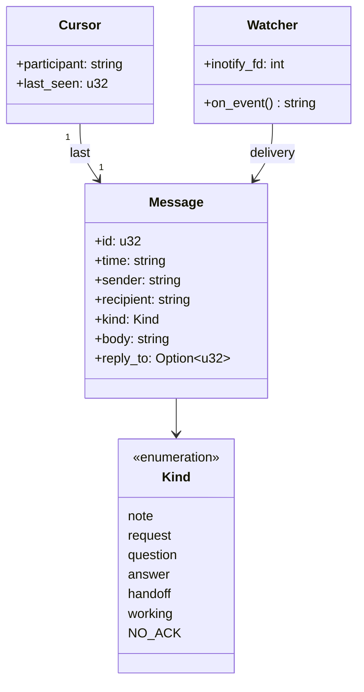
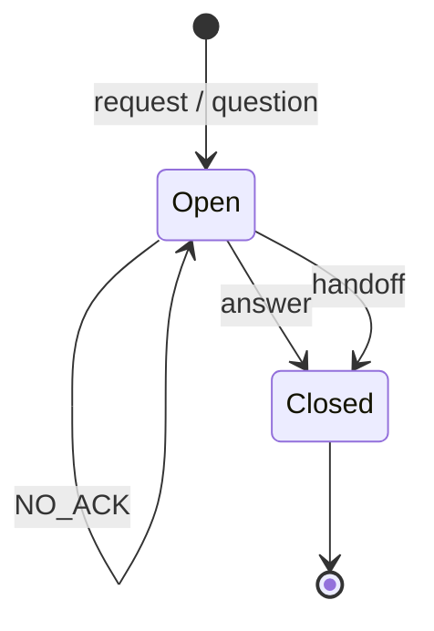
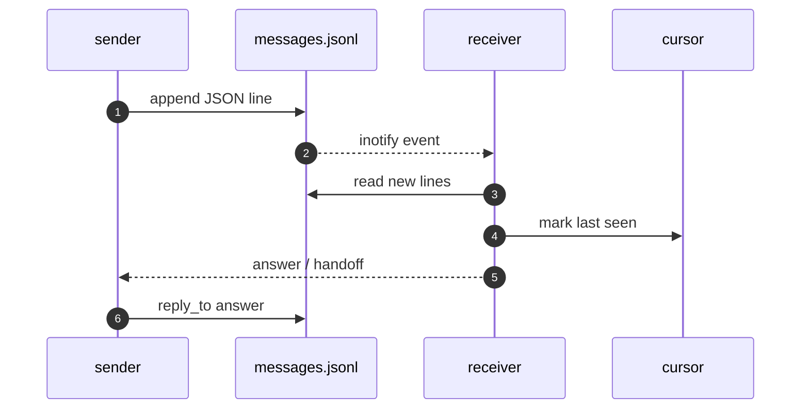
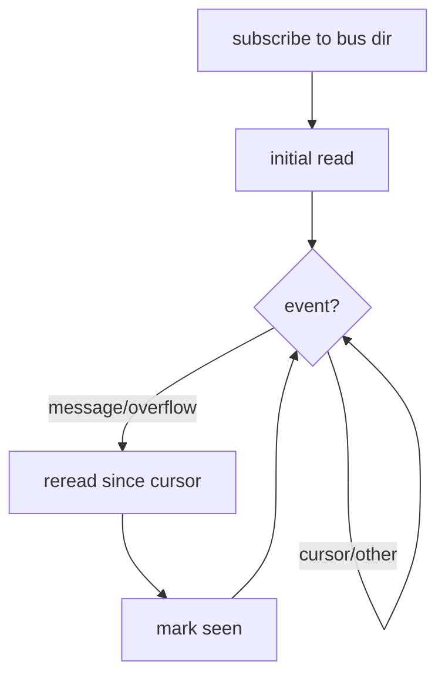

# Bus protocol

The bus is an append-only JSONL log plus a cursor per participant. It is a
visibility tool, not a scheduler.

## Message model

## Request lifecycle

Only `answer` and `handoff` close a request. `note`, `working`, and `NO_ACK`
leave it open.

## Send → wait → digest

## Direct inotify

The current implementation uses a direct inotify subscription. It subscribes
before the initial read, rereads only on an append/create/replace event or
`IN_Q_OVERFLOW`, and ignores cursor writes. Inotify setup failure is explicit,
not a polling fallback.

## Kinds and timing

| Kind | Terminal? | Use |
| --- | --- | --- |
| `request` | no | ask for work |
| `question` | no | ask for a decision |
| `note` | no | status, correction, `NO_ACK` |
| `working` | no | one compact ETA update |
| `answer` | **yes** | result or decision |
| `handoff` | **yes** | transfer ownership |
| `NO_ACK` | no | lead records a missed five-minute deadline |

For long work: send one `working` update after starting, then update only if the
ETA changes, work is blocked, or the sender asks. Do not acknowledge an
acknowledgment. The lead records one `NO_ACK` at five minutes and keeps the
request open.

## Current mode

`#0054` is closed. On resuming the dual run, `data` sent `working` in `#0070`
and closed the skeleton-family request `#0067` with answer `#0071`. The script
subscriber received both messages through inotify.
