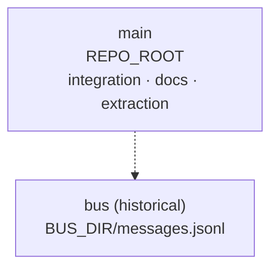
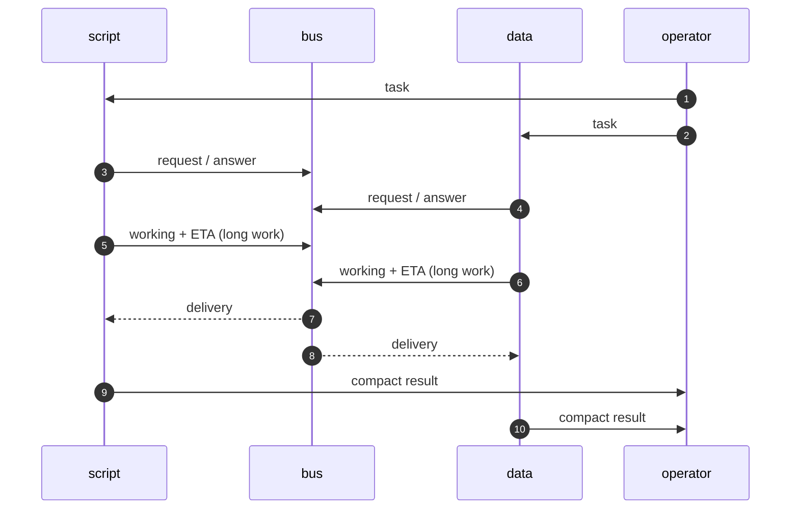
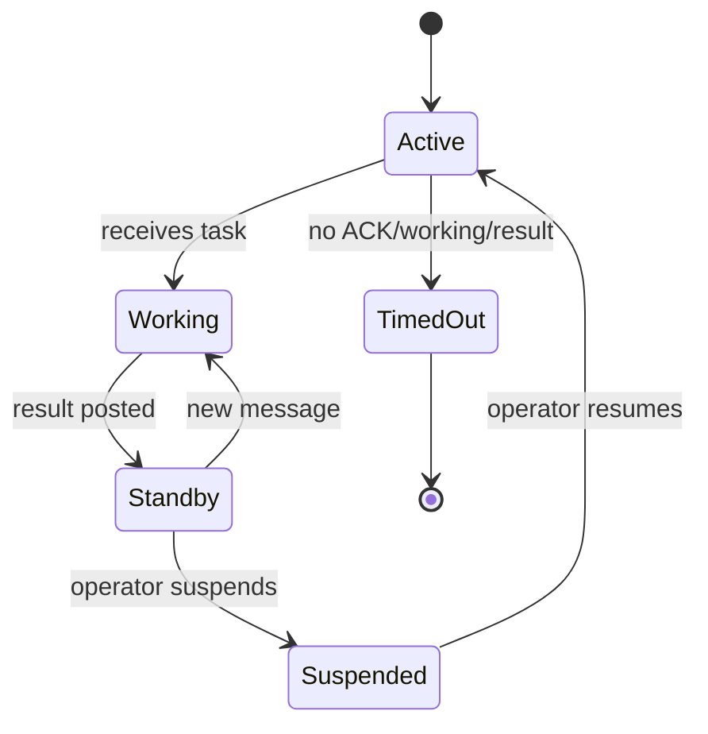
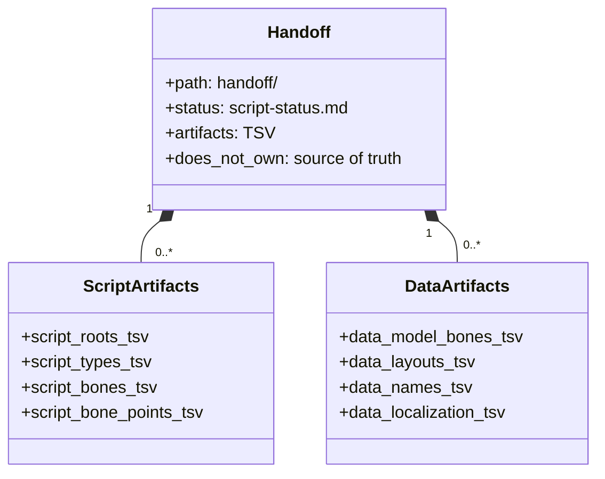

# Collaboration model

The project was built with two visible workstreams. The current run is **solo**:
the bus remains the visible handoff surface, but no session is polling it.

## Roles

| Role | Owns | Does not own |
| --- | --- | --- |
| `script` / integrator | bulk scans, extraction, tools, docs, integration | high-cost architecture calls |
| `data` / model | overall picture, hypotheses, priorities, validation | long scans |
| `operator` | direction, interrupts, arbitration | hidden RPC |

## Worktrees

The script/data worktrees were archived after consolidation; the dual-session
sequence below is retained as protocol history.

## Dual-session sequence

## Session state

## Handoff contract

## Dual-protocol status

- `main` is clean; the recent analysis commits are integrated.
- `#0054` is closed by script in `17cc1c2`.
- `#0067` is open: **owner data** maps the 16 skeleton families to
  `data.rpf`; script continues geometry/array decode in parallel.
- `#0067` closed with a negative in `#0071`. The vehicle-curve test closed in
  `#0081`; names/units stay open. Data returned to direct-inotify standby. No
  requests remain open; no polling is running.
- `handoff/` is the stable exchange surface. A data reply can resume the
  handoff without restarting the script work.

!!! note "No hidden RPC"
    Every cross-session message is a JSON line in `messages.jsonl`. The user can
    read, tail, or inject messages as `operator`.
